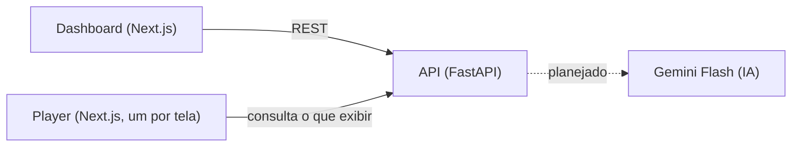

# Experience Manager: Innovation Center Accenture

Sistema web para gerenciar, de forma centralizada, o conteúdo exibido nas telas do Innovation Center da Accenture. Projeto da Squad 10, Rise-Up 2026.2 (Porto Digital).

## O problema

Hoje cada tela é configurada na mão, uma por uma. O Experience Manager permite escolher uma experiência e enviá-la para uma ou várias telas a partir de um painel. A evolução prevista é configurar as telas com comandos em linguagem natural (IA), sempre com confirmação do usuário antes de qualquer ação.

## Como funciona



- **Dashboard:** o operador vê a planta do espaço, escolhe a experiência de cada tela, liga e desliga, trava a posição e usa o Modo foco (uma tela apresenta e as outras ligadas apagam).
- **API:** guarda o estado, valida cada ação e informa ao player o que exibir.
- **Player:** página aberta em cada tela. Hoje consulta a API periodicamente; o WebSocket é a próxima etapa.

## Estrutura do repositório

```
backend/               API em FastAPI (Python)
frontend/dashboard/    painel de gerenciamento (Next.js, porta 3000)
frontend/client-app/   player exibido em cada tela (Next.js, porta 3001)
```

## Como rodar

### Back-end (Python 3.10 ou superior)

```bash
cd backend
python -m venv .venv
source .venv/bin/activate        # Windows: .venv\Scripts\activate
pip install -r requirements-dev.txt
uvicorn main:app --reload --port 8000
pytest                           # 24 testes
```

Documentação interativa da API: http://localhost:8000/docs

### Front-end (Node 20 ou superior)

```bash
cd frontend/dashboard
npm install
npm run dev                      # http://localhost:3000
```

```bash
cd frontend/client-app
npm install
npm run dev                      # http://localhost:3001
```

Enquanto a integração não é concluída, o dashboard usa rotas simuladas internas. A API em `backend/` replica o mesmo contrato, então a troca é direta.

## API em resumo

| Rota | O que faz |
|---|---|
| `GET /api/experiences` | lista o catálogo |
| `POST /api/experiences` | cria uma experiência (com validação) |
| `GET /api/clients` | lista as telas |
| `PUT /api/clients/{id}/assignment` | atribui uma experiência a uma tela |
| `PUT /api/clients/{id}/display` | liga ou desliga a tela |
| `GET /api/clients/{id}/display` | o que o player deve exibir agora |
| `PUT /api/clients/{id}/position` | move a tela na planta |
| `PUT /api/clients/{id}/lock` | trava ou destrava a posição |
| `GET/POST/DELETE /api/focus` | consulta, inicia e encerra o Modo foco |

Detalhes e formatos de erro em [`backend/README.md`](backend/README.md).

## Status

- [x] Dashboard com planta, trava de posição e Modo foco (com API simulada)
- [x] Back-end, fatia 1: contrato do front e 24 testes
- [ ] Integração entre front-end e back-end
- [ ] Persistência em banco de dados
- [ ] Tempo real com WebSocket
- [ ] Deploy na AWS com custo zero
- [ ] Assistente de IA com confirmação do usuário
- [ ] Telas reais: planta do espaço e design system da Accenture

## Decisões de projeto

- **Custo zero:** IA com Gemini Flash (free tier) e hospedagem no free tier da AWS.
- **IA só propõe:** o usuário confirma e o back-end valida antes de executar qualquer ação.
- **Telas:** hipótese de uma máquina Linux leve por tela abrindo o player em modo quiosque, em validação com os mentores.

## Fluxo de trabalho

- `main` é a branch estável e padrão.
- O trabalho acontece em branches `feat/...`, `fix/...` ou `docs/...`.
- Toda mudança entra na `main` por Pull Request, com pelo menos uma revisão.
- Mensagens de commit no padrão `feat`, `fix`, `chore` e `docs`.
